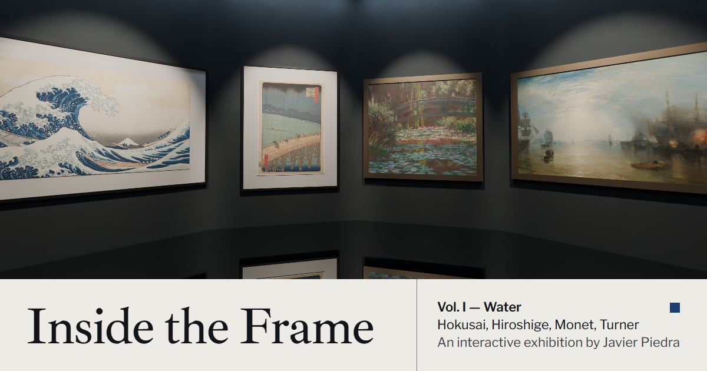

<a href="https://artgallery360.art"></a>

# Inside the Frame — Vol. I: Water

An interactive exhibition that turns four public-domain paintings about water into 360° worlds you can stand in.

**[Live site ↗](https://artgallery360.art)** · Built by [Javier Piedra](https://jpiedra.com/en/)

> Personal project. Every artwork is public domain, every texture CC0 and every typeface open-licensed (see [Credits](#credits)).

## Overview

Online collections usually show a painting as a flat image with a caption. Inside the Frame asks what it would feel like to step into one. The visitor starts in a dark gallery whose floor is flooded with still water; selecting a painting glides up to it and dives through the canvas into its world.

| Room | Painting | Collection |
| --- | --- | --- |
| I — Wave | Katsushika Hokusai, *Under the Wave off Kanagawa*, c. 1830–32 | The Metropolitan Museum of Art |
| II — Rain | Utagawa Hiroshige, *Sudden Shower over Shin-Ōhashi Bridge and Atake*, 1857 | The Metropolitan Museum of Art |
| III — Stillness | Claude Monet, *Water Lily Pond*, 1900 | The Art Institute of Chicago |
| IV — Moonlight | J. M. W. Turner, *Keelmen Heaving in Coals by Moonlight*, 1835 | National Gallery of Art, Washington |

The same approach suits museums, galleries, cultural foundations, hotels and brands that want an immersive experience people actually remember.

## Highlights

- **Worlds built in Blender, generated from code.** Every scene is produced by Python scripts in Blender 5 and rendered as an 8K equirectangular panorama with Cycles.
- **Painted, not just rendered.** The two woodblock prints are lit by emission only (flat colours), with ink outlines drawn afterwards from depth, normal and object-id passes, plus paper grain and block mottling. The two oil paintings are rendered with real light, then painted with an anisotropic Kuwahara filter, brush strokes that follow the image structure, impasto relief and canvas weave.
- **Living stills.** A semantic mask per world (R water, G sky, B light sources) drives real-time layers on top of the render: ripples on water (with drops falling in the gallery), rain in two directions with impacts on the river, flickering fires, a drifting sky, a rocking boat.
- **Water-drop transitions** dissolve one scene into the next.
- **Generative sound.** Synthesised live with Web Audio and positioned in 3D (HRTF) around the visitor — no audio files.

## Tech stack and decisions

| Area | Choice |
|---|---|
| Site | Static [Astro](https://astro.build): one page per room, readable without JavaScript, navigated without reloads when it is available |
| Viewer | A dependency-free **WebGL 2** renderer (~19 KB gzipped for the whole app) |
| 3D production | Blender 5 + Cycles, scripted in Python (`blender/scripts/`) |
| Post-processing | Python (`scripts/looks.py`, `scripts/post.py`) |
| Audio | Web Audio API with HRTF panning |
| Testing | axe-core |

- **No sphere mesh.** A single fullscreen shader casts a ray per pixel and samples the panorama: exact projection, seam-safe mipmapping, and a stereographic blend for wide portrait screens.
- **Streaming without stalls.** Panoramas stream in strips so uploads never block a frame; scenes open at 4K and upgrade to 8K on capable screens; resolution adapts to keep the frame rate smooth.

## Accessibility and performance

- Every room has a written description of its world and of the painting; the exhibition can be followed entirely without seeing it.
- **Keyboard:** arrow keys look around, + and − zoom, Tab reaches the paintings and points of interest (the view turns to show what has focus, clear of the panels), Escape closes panels and button labels.
- **Single pointer, no dragging or pinching:** on-screen buttons turn and zoom one step per click or tap, and each room card lists its points of interest ("Things to look for"); choosing one turns the view to it and opens its note.
- **Screen readers:** semantic landmarks and headings, a labelled 360° view, announcements when moving between rooms, focus management.
- Animation can be paused at any time and is off when the system asks for reduced motion; sound is opt-in.
- WCAG 2.2 AA checked with axe-core; contrast-safe surfaces over the imagery; 44 px touch targets; works from 320 px wide, in portrait and landscape, with safe-area insets.
- Without WebGL 2, the page falls back to stills and text.

## Getting started

Requires Node 22.12 or later.

```sh
npm install
npm run dev          # http://localhost:4321
npm run build        # static site in dist/
```

Set `SITE_URL` when building for production so canonical and Open Graph URLs are absolute:

```sh
SITE_URL=https://example.com npm run build
```

### Rebuilding the worlds

Requires Blender 5.0, Python 3 (`pip install -r requirements.txt`) and Node.

```sh
# 1. download the artworks (public domain, CC0) into blender/sources/ and
#    the Poly Haven textures into blender/textures/ (see Credits)

# 2. build a scene and save its .blend
blender -b --factory-startup -P blender/scripts/run_scene.py -- --scene wave --final --save

# 3. render the 8K panorama, mask and line passes
blender -b blender/wave.blend -P blender/scripts/render.py -- --name wave --width 8192 --samples 64 --passes depth,normal,id

# 4. finish, make stills, encode AVIF/WebP tiers and update src/data/assets.json
python scripts/post.py wave
python scripts/make_stills.py wave
node scripts/build-assets.mjs wave
```

Scenes: `hub`, `wave`, `rain`, `stillness`, `moonlight`. The hub script also writes `src/data/hub-geometry.json`, which the viewer uses for exact hit-testing of the paintings. `scripts/pano_views.py` previews any panorama as flat views.

## Credits

- Katsushika Hokusai, *Under the Wave off Kanagawa* — The Metropolitan Museum of Art, H. O. Havemeyer Collection, Bequest of Mrs. H. O. Havemeyer, 1929 (JP1847). Public domain, CC0.
- Utagawa Hiroshige, *Sudden Shower over Shin-Ōhashi Bridge and Atake* — The Metropolitan Museum of Art, Purchase, Joseph Pulitzer Bequest, 1918 (JP643). Public domain, CC0.
- Claude Monet, *Water Lily Pond* — The Art Institute of Chicago, Mr. and Mrs. Lewis Larned Coburn Memorial Collection (1933.441). Public domain, CC0.
- J. M. W. Turner, *Keelmen Heaving in Coals by Moonlight* — National Gallery of Art, Washington, Widener Collection (1942.9.86). Open access, CC0.
- Textures from [Poly Haven](https://polyhaven.com) (CC0): Plastered Wall 04 and Square Floor by Rob Tuytel, Oak Wood Planks by Dimitrios Savva.
- Type: Instrument Serif and Instrument Sans (SIL Open Font License).

---

Concept, 3D, sound and code by **[Javier Piedra](https://jpiedra.com/en/)** — WordPress, 3D web and accessible front-ends. Want an immersive experience for your collection or brand? [Get in touch](mailto:javierpiedraiglesias@gmail.com).
